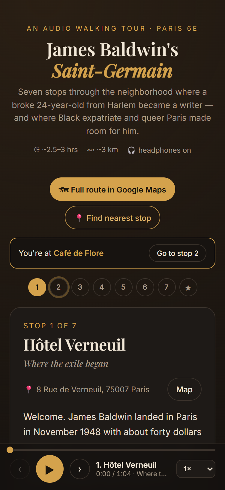
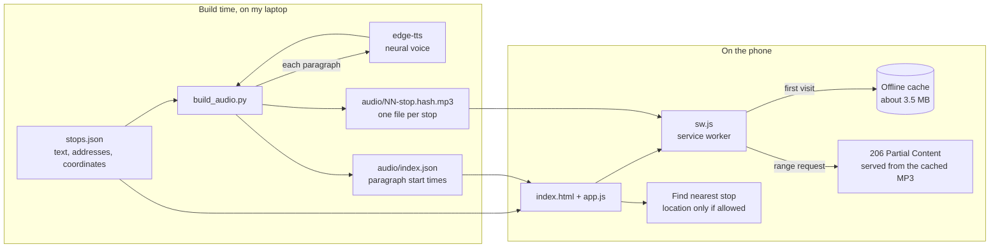

# James Baldwin's Saint-Germain — an audio walking tour

**▶ Take the tour: https://anewt225.github.io/baldwin-paris-audio-tour/**

A free, self-guided audio walking tour of Paris's 6th arrondissement. It follows James Baldwin from the night he arrived in 1948, with about forty dollars, to *Giovanni's Room*: seven stops, about three hours, plus a bonus stop at the library Paris named after him in 2024.

Built by **[Alex Newton](https://www.linkedin.com/in/anewt)** in collaboration with Claude (Anthropic). I wrote it for my own walk through Saint-Germain in 2025, then rebuilt it so anyone can take it.

<p align="center"></p>

## What it does

- **Recorded narration.** About 9 minutes of narration from a Microsoft neural voice, rendered ahead of time, so it sounds the same on every phone. Lock-screen and headphone controls work, including play/pause, skipping between stops, and seeking.
- **Tap any paragraph** to jump the narration there. The paragraph being read is highlighted as you listen.
- **Works offline.** The whole tour, audio included, is about 3.5 MB and saves to the phone on the first visit. You can add it to your home screen like an app, which helps abroad when you have no data.
- **"Find nearest stop"** uses your location (only if you allow it) to tell you which stop you're at or closest to, and how far away it is.
- **Maps built in.** One tap opens the whole walking route in Google Maps, with directions from each stop to the next and transit directions for the bonus stop.
- **Deep links.** `…/#4` opens straight to stop 4.

## How it's built

There's no framework and no build step for the page itself. It's a few small static files on GitHub Pages:

```
stops.json               ← the script: every stop's text, address, coordinates, walking note
scripts/build_audio.py   ← renders stops.json → audio/*.mp3 + audio/index.json
index.html · app.js · styles.css
sw.js                    ← service worker: offline caching
manifest.webmanifest     ← installable as an app
```



**The script is data.** All the writing lives in `stops.json`. `build_audio.py` sends each paragraph to a neural voice through [edge-tts](https://github.com/rany2/edge-tts), joins the clips into one MP3 per stop, and records each paragraph's start time. That's what makes tap-to-seek and highlighting work without speech-to-text alignment. Each file name includes a hash of its text, so editing one stop re-renders only that stop. Phones also pick up the new audio instead of a stale cached copy.

To change the narration you need [uv](https://docs.astral.sh/uv/) and Python 3.14 or later (set in `pyproject.toml`):

```bash
uv sync
uv run scripts/build_audio.py      # re-render only the stops whose text changed
uv run scripts/make_icons.py       # regenerate app icons
```

**Offline audio on iPhone took extra work.** Safari asks for audio in byte ranges, and it won't play a cached file served back as a single full response. The service worker therefore caches each MP3 whole and answers range requests from that copy (`206 Partial Content`). I tested this by shutting the server down completely and checking that the tour still loads, plays, and seeks.

**v1 → v2.** The first version was one HTML file that read the text aloud with the phone's built-in voice. It was quick to make, but the voice changed from phone to phone, often sounded robotic, and stopped when the screen locked. v2 keeps the same design and text and replaces the parts that don't hold up on a real walk.

## Working with AI

Claude was a collaborator throughout: researching the history, drafting and tightening the narration, and writing and testing the code. I directed the scope, chose the route, and fact-checked the claims. I also made the product decisions: recorded audio instead of the device voice, offline-first, and location as opt-in. The commit history shows how it evolved.

## What this shows

- **Testing in real conditions.** v1 worked at a desk and failed on a walk: the voice changed from phone to phone, and playback stopped when the screen locked. v2 is the result of testing where the product is actually used, then fixing what broke there.
- **Content separated from code.** The narration lives in one data file, so editing the text doesn't touch the app. And because audio files are named by a hash of their text, a change to one stop re-renders and re-downloads only that stop.
- **Privacy by default.** Location is opt-in and never leaves the phone (the distance math runs in the browser). There's no analytics and no account.
- **A scoped AI collaboration.** Claude did the research legwork, the drafting and the code. Scope, route, fact-checking and every product decision were mine.

## Sources & further reading

The narration draws on Baldwin's own essays (*Notes of a Native Son*, *Nobody Knows My Name*, especially "Equal in Paris" and "Alas, Poor Richard") and on William Gardner Smith's *The Stone Face*. It also draws on published walking tours and features about Baldwin's Paris, including *The New York Times*'s "James Baldwin's Paris". Café opening hours change, so check before you go. Corrections are welcome: open an issue.

## License

Code: MIT. Narration text © Alex Newton.
